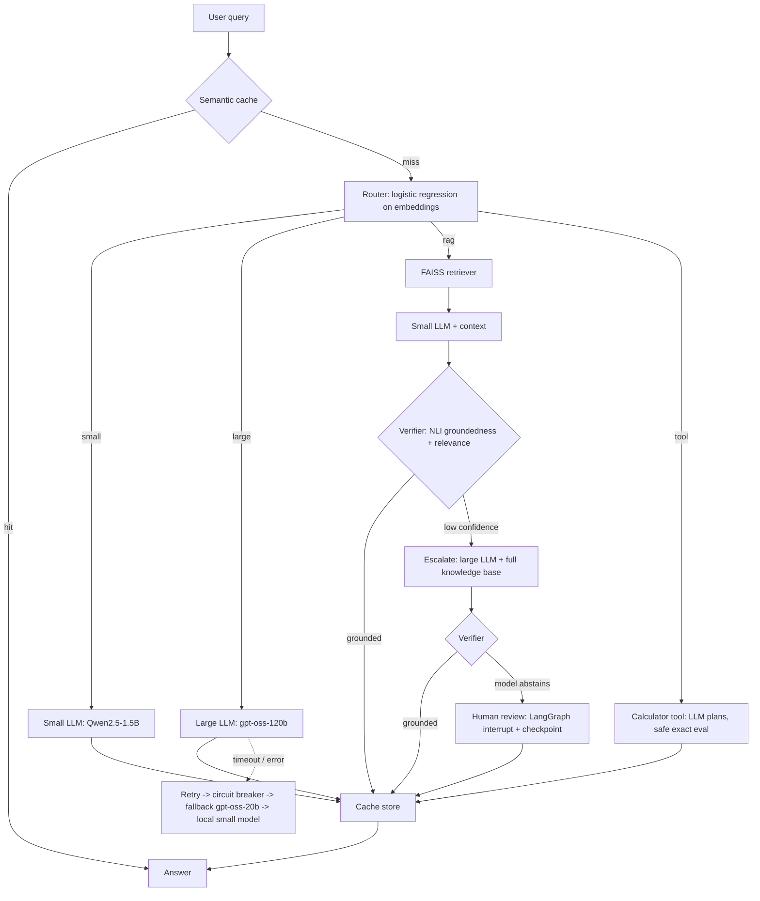
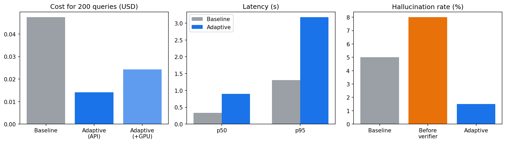
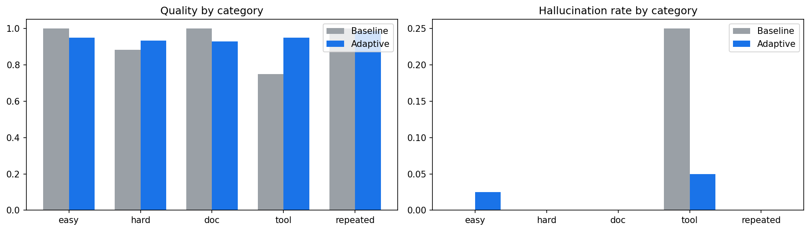
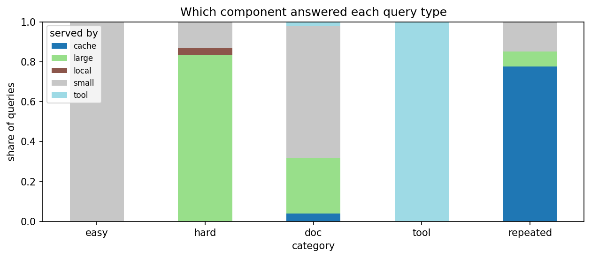

# Agentic LLM Gateway

Adaptive, reliable and cost-aware LLM routing with **LangGraph**. For every request the gateway decides which model to use, checks whether the answer can be trusted, and recovers from failures on its own (retry, escalate, fall back, or ask a human). Built and benchmarked on a **Google Colab free-tier GPU (T4)**.

## Why

Sending every request to a large model is slow and expensive; sending everything to a small model is cheap but can hallucinate. The gateway routes each query to the cheapest component that can answer it reliably.

## Architecture

&nbsp;

| Component | What it does |
| :---- | :---- |
| Semantic cache | Reuses answers for similar questions; guarded by an entity check so "capital of India" never hits "capital of France" |
| Router | 4-way classifier (small / large / RAG / tool) |
| RAG retriever | FAISS \+ MiniLM embeddings over the knowledge base |
| Tool node | LLM writes calculation steps, Python evaluates them exactly (no arithmetic hallucination) |
| Verifier | Sentence-level NLI entailment \+ query-answer relevance; low confidence triggers escalation |
| Fault tolerance | Timeouts, exponential-backoff retries, circuit breaker, fallback chain, local-model last resort |
| Human-in-the-loop | Graph pauses (interrupt \+ checkpoint) when even the large model cannot answer; human approves, edits or rejects |
| Observability | LangSmith traces every step (latency, tokens, route, failures) |
| Dashboard | Gradio app comparing adaptive routing vs always-large |

&nbsp;

## Results

Benchmark: 200 queries (easy, hard, document-based, tool-based, repeated). Run shown: **Final run (shipped config, retry OFF)**. Baseline \= every query sent to gpt-oss-120b.

| Metric | Always-large baseline | Adaptive gateway | Change |
| :---- | :---- | :---- | :---- |
| API cost (USD, 200 queries) | \$0.0475 | \$0.0141 | \+70.3% cheaper |
| Cost incl. GPU time (USD) | \$0.0475 | \$0.0243 | \+48.8% cheaper |
| Latency p50 (s) | 0.34 | 0.90 | \-166% (negative \= slower) |
| Latency p95 (s) | 1.31 | 3.18 | \-143% (negative \= slower) |
| Quality (mean judge score) | 0.932 | 0.950 | \+0.017 |
| Hallucination rate | 5.0% | 1.5% | before verifier: 8.0% |
| Semantic cache hit rate | \- | 16.5% | 78% on repeated; false hits: 2 |
| Handled without large model | 0% | 78.5% | small \+ tool \+ cache |
| Small-model answers fully correct | \- | 91.6% | n=83 |
| Router accuracy (grouped CV) | \- | 97.5% | 4 routes: small/large/rag/tool |
| Recovery under injected failures | \- | 100% | flaky / timeout / all APIs down |

&nbsp;

### By category

| Category | Baseline quality | Adaptive quality | Adaptive hallucination | Adaptive p95 (s) |
| :---- | :---- | :---- | :---- | :---- |
| doc | 1.0 | 0.93 | 0.0 | 2.11 |
| easy | 1.0 | 0.95 | 0.025 | 2.365 |
| hard | 0.883 | 0.933 | 0.0 | 2.365 |
| repeated | 1.0 | 0.988 | 0.0 | 1.86 |
| tool | 0.75 | 0.95 | 0.05 | 3.806 |

&nbsp;

### Routing

### Reliability (failure injection, 60 queries per scenario)

| Scenario | Queries | Answered % | Quality | p95 latency (s) | Served by |
| :---- | :---- | :---- | :---- | :---- | :---- |
| Large model flaky (50% errors) | 60 | 100.0 | 0.973 | 2.43 | small 47%, tool 25%, cache 15%, fallback 12%, local 2% |
| Large model timing out | 60 | 100.0 | 0.956 | 5.02 | small 60%, tool 25%, fallback 7%, local 7%, cache 2% |
| All API models down | 60 | 100.0 | 0.944 | 5.6 | small 60%, tool 25%, local 13%, cache 2% |

&nbsp;

## Key findings

- **Cost:** API spend down **70.3%** vs always-large; 78% of queries never touch the large model.  
- **Trust:** hallucination rate **8.0% \-\> 1.5%** after adding the verifier (baseline: 5.0%).  
- **Tool use:** the calculator node is exact, while the always-large baseline gets only 75% of arithmetic queries fully right.  
- **Reliability:** every query was answered under injected failures (flaky large model, timeouts, all APIs down).  
- **Retry ablation:** retry-with-more-context rescued only 11% of failed verifications, so the shipped config escalates directly.

## Trade-offs and limitations

- **Latency is higher than always-large** (p95 3.2s vs 1.3s). The small model runs on a Colab T4, slower than Groq's hosted API. The gateway wins on cost and trust, not speed, in this setup.  
- GPU cost is a notional estimate (\$0.35/hr T4 on-demand); API prices are Groq list prices at the time of the run.  
- Small benchmark: 200 queries over a 12-document synthetic knowledge base; the judge is an LLM (gpt-oss-20b) with a numeric check for tool queries.  
- Router accuracy (97.5%) is from grouped cross-validation on the same distribution it was trained on.

## Tech stack

LangGraph, LangSmith, Qwen2.5-1.5B (HF Transformers, fp16), Groq (gpt-oss-120b / gpt-oss-20b), FAISS, sentence-transformers (all-MiniLM-L6-v2), DeBERTa NLI cross-encoder, scikit-learn, Gradio.

## Run it

1. Open Agentic\_LLM\_Gateway.ipynb in Google Colab (GPU runtime).  
2. Add GROQ\_API\_KEY and LANGSMITH\_API\_KEY in Colab Secrets.  
3. Run the cells in order; results are saved to Google Drive and the last cells launch the dashboard.

## Resume line

Built an agentic LLM gateway with LangGraph (adaptive routing, RAG, NLI hallucination verification, semantic caching, tool use, human-in-the-loop, circuit breakers) with full LangSmith tracing; cut API inference cost by 70% vs an always-large-model baseline, reduced hallucination rate from 8.0% to 1.5%, and kept 100% of queries answered under injected model failures.